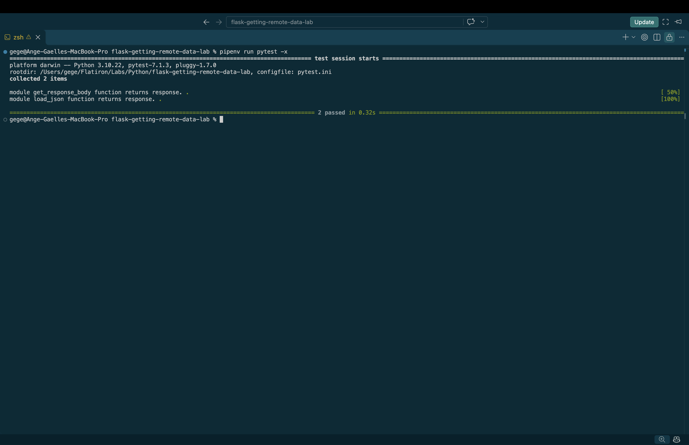

# Retrieving Remote Data from an API

## Overview

The goal of this lab is to retrieve remote data from an API using Python's `requests` library and convert JSON responses into Python data structures.

The project implements a reusable `GetRequester` class that handles HTTP GET requests and JSON parsing.

## Technologies Used

- Python 3
- Requests
- JSON
- Pipenv
- Pytest

## Installation

Clone the repository:

```bash
git clone git@github.com:a-gbatie/flask-getting-remote-data-lab.git
cd flask-getting-remote-data-lab
```

Install dependencies:

```bash
pipenv install
```

Run Python within the virtual environment:

```bash
pipenv run python
```

## API Endpoint

The project retrieves employee information from:

https://learn-co-curriculum.github.io/json-site-example/endpoints/people.json

The API returns JSON data containing employee names and occupations.

## Implementation

### GetRequester Class

The `GetRequester` class is located in `lib/GetRequester.py`.

It contains two methods for retrieving and processing remote data.

### 1. get_response_body()

This method sends an HTTP GET request to the specified URL and returns the raw response body as bytes.

```python
def get_response_body(self):
    res = requests.get(self.url)
    return res.content
```

**Explanation:**

- `requests.get(self.url)` sends an HTTP GET request.
- `res.content` retrieves the response body as bytes.
- The method returns the retrieved data.

### 2. load_json()

This method converts the retrieved JSON response into Python data structures.

```python
def load_json(self):
    res = self.get_response_body()
    return json.loads(res)
```

**Explanation:**

- Calls `get_response_body()` to retrieve the API response.
- Uses `json.loads()` to deserialize JSON data.
- Returns the resulting Python object.

## Usage

Start the Python shell:

```bash
pipenv run python
```

Import the class:

```python
from lib.GetRequester import GetRequester
```

Initialize the requester:

```python
url = "https://learn-co-curriculum.github.io/json-site-example/endpoints/people.json"

requester = GetRequester(url)
```

Retrieve the raw API response:

```python
response = requester.get_response_body()
print(response)
```

Convert the JSON response into Python data:

```python
data = requester.load_json()

print(data)
print(type(data))
```

## Testing

The project uses Pytest to verify that both methods work correctly.

Run the tests:

```bash
pipenv run pytest
```

### Test Coverage

The tests verify that:

1. `get_response_body()` retrieves and returns the expected API response.
2. `load_json()` correctly converts the JSON response into Python data.

## Screenshot of Completed Tests
